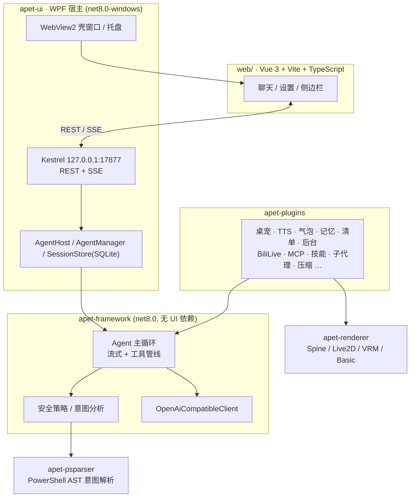

# APet

Windows 桌面 AI Agent 工作台。C# / .NET 8 自研 Agent 框架与插件生态,WPF 壳承载 Vue 3 前端。接入任意 OpenAI 兼容 API,让模型获得读写文件、执行终端命令、抓取网页、截屏看世界的能力,并以多层安全策略约束每一次工具调用;配套桌宠(Spine / Live2D / VRM)、语音播报、长期记忆、子代理、B 站直播互动等 14 个内置插件。

> **当前状态**:功能完备的个人项目,源码公开(source-available):可自由使用(个人与商用均可),但**不得修改或再分发**,许可全文见 [LICENSE](LICENSE)。

## 功能特性

**模型与对话**

- OpenAI 兼容流式协议:思考增量、`usage` 统计、多模态内容(`image_url` / `file` 片段)、`/v1/models` 拉取
- 多供应商管理:每供应商维护多模型(上下文大小 / 最大输出),聊天页一键切换;思考等级(none / default / minimal ~ max)与思考字段样式按端点适配(GLM / Qwen / OpenAI 风格)
- 工具调用行:实时参数流式预览、写文件行号 diff、编辑红绿对照、终端输出流光滚动,原始 JSON 不上界面
- 会话:SQLite 行级增量存储、置顶 / 文件夹(支持嵌套)/ 拖拽排序 / 归档 / 分叉 / `/undo` 回滚,多窗口经 SSE 实时同步
- 上下文压缩:阈值触发或 `/compact` 手动,summarize / truncate 双策略;总结请求保留真实上下文以命中前缀 KV 缓存

**能力(内置工具)**

- `ask` 结构化询问、`read_file` / `write_file` / `edit_file` / `apply_patch`、`bash`(三 Shell + 编码自动判定)、`web_fetch`(跳转跟随 + 代理)、`screenshot` / `view_image`(视觉)
- 插件工具:长期记忆 `mem_*` ×6、任务清单 `todo_*`、后台运行 `bg_*` ×5、技能 `skill`、子代理 `sub_*` ×5、B 站直播 `bili_live_events` / `mute`、MCP 工具代理 `mcp_{服务器}_{工具}`

**安全模型**

- 每次工具调用先做效果分析(访问种类 + 受影响路径),再经安全策略判定,未放行转宿主卡片确认
- 目录权限分级(只读 / 读写 / 完全访问 / 全部询问)+ 按工具类别的目录白名单
- Shell 命令意图解析:bash/cmd 词表推演 + PowerShell 官方解析器 AST 精确推演(`apet-psparser`),尽力提取真实读写路径参与鉴权

**桌宠与语音**

- 四引擎桌宠(Spine / Live2D / VRM / 图片序列)共用同一状态机:待机轮换、眨眼、点击交互、拖动记忆
- TTS 三引擎(自定义 HTTP 服务 / Windows SAPI / GSV 本地 ONNX),逐句流式合成
- 情绪标签联动:模型输出 `[happy]` 式标签 → 宠物做动作、语音换声线,与发声严格同步

**扩展体系**

- 插件框架:system prompt 注入、消息链钩子、注册 LLM 工具与 `$` 聊天指令、设置自动表单与热应用
- 外部插件 = 一个 DLL:可内嵌自定义 Web UI(同源 iframe + 桥接 API),支持数据面与事件推送(见 [docs/external-plugin-guide.md](docs/external-plugin-guide.md))
- 子代理:预配置专家(提示词 + 工具集 + 模型),主 Agent 经 `sub_run` 委派、`sub_wait` 收结果、`sub_tell` 中途传话
- 技能:SKILL.md 文件夹约定(兼容 Codex 技能),`skill` 工具按需加载全文
- MCP 客户端:stdio / Streamable HTTP / SSE 三传输,服务器工具代理注册进统一鉴权管线

## 架构



| 项目 | 目标框架 | 职责 |
|------|----------|------|
| `apet-framework` | net8.0 | Agent 核心:LLM 客户端、工具注册与执行管线、安全鉴权、会话、插件接口。**零 UI 依赖**。 |
| `apet-psparser` | net8.0 | PowerShell 官方解析器 AST 精确意图推演(反射调用,PS5/PS7 兼容)。 |
| `apet-plugins` | net8.0-windows | 14 个内置插件(见[插件系统](#插件系统))。 |
| `apet-renderer` | net8.0-windows | 桌宠渲染层:四引擎 + 统一逐像素透明悬浮窗(`OverlayWindow`),契约 `IPetRenderer`。 |
| `apet-ui` | net8.0-windows | 宿主:Kestrel Web 服务、SQLite 会话存储、托盘多 Agent 管理、TTS 播放;只做装配接线。 |
| `web/` | — | Vue 3 前端(聊天 / 设置 / 插件页),构建产物由宿主伺服;`public/apet-bridge.js` 供插件 UI 桥接。 |
| `plugins-sample/` | — | 外部插件示例:HelloPlugin(全套能力)、NvidiaMonitor(GPU 面板 + 状态栏)。 |

依赖方向:`apet-ui → apet-plugins → apet-framework`,框架不感知任何 UI 与配置实现;插件之间不互相引用,跨插件协作经宿主注入的委托(如气泡的 `IPetAnchor`)。

## 快速开始

### 环境要求

- **只运行**:Windows 10/11 x64,**零依赖**——部署产物为自包含发布(.NET 运行时已打包),不需要安装 .NET / WebView2 / 任何运行库
- **从源码构建**:.NET 8 SDK + Node.js 18+

### 构建与运行

```bash
# 1. 构建前端(产物进入 apet-ui 输出目录 wwwroot)
cd web && npm install && npm run build && cd ..

# 2. 构建并运行桌面宿主(开发调试用;正式分发走下方一键部署)
dotnet run --project apet-ui
```

首次运行在 `%APPDATA%\APet\` 生成用户数据(见[数据与配置](#数据与配置));启动后自动打开聊天窗口,在「设置 → 模型服务」里添加供应商(BaseURL / APIKey / 模型)即可开始对话。

### 一键部署

```bash
deploy.cmd
```

构建 Web 前端,然后以 **Release 自包含**方式发布 C# 全链到仓库根的 `dist\` 目录(可用环境变量 `APET_DEPLOY_DIR` 覆盖),完成后自动启动——**双击 `deploy.cmd` 即可完成部署**。dist 内已打包 .NET 运行时,拷到任何 Win10/11 x64 机器都能直接跑;GSV 引擎与 Live2D 的原生 DLL 部署时自动从 GitHub Release 下载(见 deploy.cmd 内 `NATIVE_BASE`)。用户数据在标准目录(见下),升级 / 重装程序不影响数据。

> 部署前请结束运行中的 `APet.UI.exe`,否则 DLL 被锁定(MSB3027)。

## 数据与配置

程序目录只放程序;运行期数据按 Windows 约定分两处(环境变量 `APET_DATA_DIR` / `APET_CACHE_DIR` 可整体覆盖到其他位置,便携部署用):

```
%APPDATA%\APet\                     # 用户资产(重装保留)
├── setting.json                    # 全局注册表:激活 Agent 与排列(仅此两项)
└── agents/{id}/
    ├── setting.json                # 该 Agent 的全部设定(供应商 / 工具 / 权限 / 插件设置)
    ├── sessions/sessions.db        # 会话(SQLite:上下文消息行级增量写,压缩删除的消息留档)
    ├── images/{sessionId}/         # 会话图片附件(内容哈希命名)
    ├── memory.db                   # 长期记忆(SQLite,全部会话共享)
    ├── todos/                      # 任务清单(按会话)
    └── avatar.*                    # Agent 头像

%LOCALAPPDATA%\APet\                # 机器本地(可再生,可随手清)
├── logs/apet.log                   # 运行日志
├── webview2/                       # WebView2 用户数据目录(Chromium 缓存)
└── workspaces/ws-{会话短Id}/       # 未设工作目录的会话自动创建的临时工作区
```

`agents/{id}/setting.json` 为 JSONC(容忍注释与尾逗号,中文原样写出),节选:

```jsonc
{
  "Name": "APet",
  "SystemPrompt": "You are APet, ...",
  "Llm": {
    "Providers": [ /* 名称/BaseUrl/APIKey/模型清单/思考等级 */ ],
    "ActiveProvider": "DeepSeek",
    "ProxyMode": "system"            // system / none / 自定义地址
  },
  "AutoCompress": true,
  "Security": { "OtherDirectoriesAccess": "ReadOnly", "Whitelist": [] },
  "BiliLive": { "RoomCode": "", "Cookie": "" }
  // Tts / DesktopPet / Skills / SubAgents / Mcp / pluginSettings ...
}
```

删除某 Agent 即删除其整个文件夹;删除全局 `setting.json` 仅丢失激活与排序(Agent 档案按 `agents/` 目录扫描自动恢复)。

## 内置工具

| 工具 | 权限类别 | 说明 |
|------|----------|------|
| `ask` | 无 | 对不明确的决定向用户发起结构化询问(多题 / 单多选 / 自由输入),宿主 UI 呈现。 |
| `read_file` | read | 读取文本文件,自动探测编码;相对路径基于会话工作目录。 |
| `write_file` | edit | 写入 / 追加文本文件(UTF-8 无 BOM)。 |
| `edit_file` | edit | 精确字符串替换:唯一匹配或 `replace_all`,未找到 / 多义返回结构化错误;按原文件编码写回。 |
| `apply_patch` | edit | 统一 diff 补丁,支持漂移定位与全局回退搜索。 |
| `bash` | terminal | 可配置 Shell(PowerShell / pwsh / cmd / bash)执行单条命令,返回 exit_code / stdout / stderr / timed_out;意图分析器从命令中提取受影响路径参与鉴权。 |
| `web_fetch` | 无 | HTTP(S) GET 抓网页转纯文本:去标签、自动跟进 meta refresh / JS 跳转、提取超链接;代理跟随 LLM 设定;拒绝内网 / 回环目标地址。 |
| `search_files` | read | 递归按正则/子串搜文件内容:返回文件/行号/匹配文本,支持上下文行、glob 过滤、编码自动判定(BOM/UTF-8/GBK);二进制与超大文件跳过。 |
| `find_files` | read | 按 glob 递归找文件(`**/*.frm`、`*.go`),返回绝对路径与命中总数。 |
| `screenshot` | 无 | 截取主屏或指定屏幕,以图片回传视觉模型。 |
| `view_image` | read | 读取磁盘图片文件回传视觉模型。 |

所有工具走统一鉴权管线;设置页按功能分组开关,并可限制工具调用最大循环轮数。

## 安全模型

```
请求 → 效果分析(AnalyzeEffect: 访问种类 + 受影响路径) → 安全策略判定
     ├─ 放行 → 执行
     └─ 未放行 → 宿主回调(默认拒绝;UI 弹卡片让用户决定,可"信任此目录")
```

- **工作目录权限分级**(与会话绑定,首条对话后锁定):只读 / 读写 / 完全访问 / 全部询问。
  - **只读**:文件读取放行,终端仅放行只读命令;写入与效果未知的调用一律弹卡确认。
  - **读写**:文件操作限工作目录内(目录外写入需确认);终端命令除灾难清单外静默执行。
  - **完全访问**:全部放行,含工作目录外与效果未知的调用。
  - **全部询问**:所有调用逐次确认(连读取都要)。
- **灾难命令清单**:递归删除、磁盘格式化、`git reset --hard`、强推等高危终端命令,除完全访问外任何档位都逐次确认,目录白名单不豁免。
- **目录白名单**按工具类别(read / edit / terminal / 工具名)生效,由确认卡「信任此目录」写入——目录可读不代表可写。
- **web_fetch 溢出落盘例外**:正文超过视口上限时,完整内容写入固定缓存目录(%LocalAppData%\APet\fetch-cache);该目录由宿主固定、模型不可指定、不写入用户工作区,故不纳入目录权限档位管辖,目录内容只作读回,不参与任何路径解析或执行。
- 效果无法解析的调用按 Unknown 处理:完全访问档或命中白名单时放行,其余弹卡确认(fail-closed)。
- Web 服务**仅绑定 127.0.0.1** 并校验 Host / Origin 来源(仅接受本机回环访问);端点仍无鉴权,配置接口会回传明文密钥,切勿改绑到局域网 / 公网。

## 上下文压缩

估算上下文 Token 达到「上限 × 阈值%」时自动触发(或 `/compact` 手动):

- **summarize**:让模型把旧消息总结为摘要,构造 `[system, 摘要, 最近消息]` 的新上下文;真实上下文原样保留、压缩模板追加在末尾,整段命中前缀缓存,只有模板按全价计费;摘要随会话落盘,重复压缩可续接。
- **truncate**:保留窗口之外直接丢弃。
- 压缩只影响请求组装,不改写界面显示的聊天记录;内置多种摘要预设(通用 / 编程开发等),模板可自定义。

## 插件系统

插件比工具更高一层:贡献 system prompt、介入消息链(请求前 / 流式增量 / 消息完成 / 运行收尾)、注册 LLM 工具与 `$` 聊天指令、声明设置项自动生成表单并持久化。内置 14 个:

| 插件 | 作用 |
|------|------|
| `desktop-pet` | 桌宠显示与状态机(见[桌宠](#桌宠与语音))。 |
| `tts-client` | 语音播报三引擎(见[桌宠与语音](#桌宠与语音))。 |
| `chat-bubble` | 漫画气泡窗:锚定宠物上方流式显示对话文本,样式可调,点击打开聊天窗。 |
| `memory` | 长期记忆(SQLite 跨会话):六个 `mem_*` 工具,按上下文预算截断返回,N 天未使用自动遗忘。 |
| `todo` | 任务清单:`todo_write / todo_read`,按会话隔离,侧边栏实时展示。 |
| `background` | 后台运行:`bg_run / bg_output / bg_wait / bg_kill / bg_list`,耗时命令放后台,增量看输出。 |
| `bili-live` | B 站直播接入(见 [B 站直播](#b-站直播))。 |
| `SubAgent` | 子代理委派:预配置专家 + `sub_*` 五工具,主会话停止即级联终止,侧边栏 / 模态框实时观测。 |
| `Skills` | 技能:`~/.apet/skills/<名>/SKILL.md`,`skill` 工具按需加载,`$skills` 查看清单。 |
| `Mcp` | MCP 客户端:stdio / HTTP / SSE 服务器,工具代理走统一鉴权,服务器 instructions 注入。 |
| `context-compression` | 上下文压缩(见上文)。 |
| `env-context` | 环境注入:工作目录 / OS / 日期 / 时区(日期只到日粒度,缓存友好)。 |
| `scene` | 会话情景:`$scene` 指令按预设注入提示词。 |
| `language` | 回复语言(zh / ja / en)注入,TTS 朗读语言同源。 |

### 外部插件

引用 `APet.Framework.dll` 的类库 DLL 放进 `plugins\` 即被加载:设置项自动生成表单、可携带内嵌 Web UI(同源 iframe 渲染,桥接 API 读写设置 / 数据面 / 事件 / 宿主 DOM)、数据面 REST + SSE 推送。完整指南与可编译示例见 [docs/external-plugin-guide.md](docs/external-plugin-guide.md) 与 [plugins-sample/](plugins-sample/)。

## 桌宠与语音

**桌宠**(`desktop-pet` 插件)在独立逐像素透明悬浮窗显示模型,四引擎共用状态机:

| 引擎 | 模型 | 特点 |
|------|------|------|
| Spine | .skel/.json + atlas | 骨骼动画,眨眼用动作实现。 |
| Live2D | .model3.json | Cubism Core 原生渲染;内建眨眼 / 呼吸;表情 = 参数级叠层,不占动作轨;支持捏表情编辑器与部件不透明度基线。 |
| VRM | .vrm | 纯 C# 解析 + OpenTK 渲染(MToon / Toon / PBR 三风格);表情 + VRMA 动画;弹簧骨物理。 |
| Basic | 图片文件夹 | 图片序列动作,可配淡入淡出。 |

情绪映射(tag → 动作/表情)、待机轮换(± 随机抖动)、周期眨眼、单击/双击/右键行为均可配置;窗口标题带 Agent 名与引擎名,方便 OBS 捕获。

**语音**(`tts-client` 插件):逐句(流式句尾即合成)或整条回复后合成;不朗读圆括号内心独白;情绪标签切换其后文本的声线。三引擎:自定义 HTTP 服务(OpenAI 兼容 `/v1/audio/speech`)、Windows SAPI 系统语音、GSV 本地 ONNX 推理(模型包 + 每声线参考音频 + 标点停顿 + 采样参数,`$warmup` 预热)。播放走 NAudio 常驻 WASAPI 共享输出,自动重采样,音量为程序内增益。

> GSV 的**通用底座模型包**(GPT-SoVITS 底模 + 特征/词典,不含任何角色声线)由 `deploy.cmd` 部署时自动从 GitHub Release 下载到程序旁 `models\`;模型目录留空即自动使用它。**角色声线模型与参考音频需自行训练/准备**(设置页创建声线,指向你的模型与 wav)——分发的包刻意不含任何特定角色音色。Spine / Live2D / VRM 的模型文件请使用你拥有授权的资源。

## B 站直播

`bili-live` 插件直连 B 站直播 comet 协议(WBI 签名 + 官方 WebSocket,多线路回退、断线退避重连):

- 事件解析:弹幕(`DANMU_MSG`)、礼物(`SEND_GIFT_V2` protobuf 与旧 JSON 兜底)、醒目留言 SC(新旧双结构)、上舰(`GUARD_BUY` 金瓜子 1000 = ¥1 校准)、关注 / 分享互动
- 管线:关键词屏蔽 → FIFO 队列(付费事件挤掉弹幕保位)→ 合并窗口 → 最小间隔限频 → 作为工具结果注入对话
- 行为协议:观众是第三方不是用户;灌水默认 `mute()` 静默,礼物 / SC / 必谢互动点名致谢;侧边栏实时滚动 + 连接状态指示;`$blive` 绑定会话(随 Agent 设定持久化)
- 侧边栏显示连接状态机(解析 / 连接 / 认证 / 已连接 / 重试 / 等待开播)

## 聊天命令

`/` 与 `$` 均有补全面板(上下键选择、Tab/Enter 补全):

| 命令 | 说明 |
|------|------|
| `/new` | 新建会话并切换 |
| `/compact [说明]` | 立即压缩上下文,可附加说明 |
| `/summary` | 查看当前会话摘要 |
| `/undo` | 撤销上一条消息:会话回滚,原文返回输入框 |
| `/fork [名字]` | 分叉当前会话副本 |
| `$scene 名称` | 注入预设情景(空参数清空) |
| `$skills` | 查看技能清单 |
| `$warmup` | 预热 TTS(GSV)当前声线 |
| `$blive [off]` | 绑定 / 解绑当前会话接收直播消息 |

## 开发指南

- **新增内置工具**:在 `apet-framework/Tools/BuiltIn` 实现 `ToolBase` 子类(`Definition` + `ExecuteAsync`,必要时重写 `AnalyzeEffect` 声明文件影响),在 `ToolRegistryExtensions.RegisterBuiltIns` 注册;展示分组加入 `apet-ui/Services/ToolCatalog`。
- **新增内置插件**:继承 `AgentPluginBase`(设置项用 `[PluginSetting]` 注解),在宿主 `AgentHost` 装配处注册;跨插件协作一律经宿主注入的委托。
- **宿主回调**:`IAgentCallbacks`(思考 / 正文 / 工具 / 鉴权 / 完成 / 用量 / 错误)带默认空实现,按需重写;框架层的字符串字面量一律英文(会进入 LLM 上下文),注释与 UI 文本用中文。
- **外部插件**:见 [docs/external-plugin-guide.md](docs/external-plugin-guide.md),示例在 [plugins-sample/](plugins-sample/)。
- **前端开发**:`cd web && npm run dev`(Vite 代理到本地宿主);构建产物经 `apet-ui.csproj` 拷入 wwwroot。

## 设计约定

- 命名空间统一 `APet.*`(`APet.Framework` / `APet.UI` / `APet.Plugins` / `APet.Renderer`)。
- 框架零 UI 依赖;`apet-plugins` 不反向引用 `apet-ui`;四桌宠引擎与统一透明窗都在 `apet-renderer`,插件层只经 `IPetRenderer` 契约交互。
- 情绪标签的注入 / 解析统一走 `EmotionTagCodec`,插件设置推送统一走框架 `PluginConfigBridge`(按 `[PluginSetting]` 反射匹配,新增设置无需改宿主装配代码)。
- 提交信息用中文、里程碑粒度提交。

## 文档

- [外部插件开发指南](docs/external-plugin-guide.md) —— 能力边界、设置注解、UI 插槽与桥接 API、行为细节

## 许可

本仓库整体以 [APet Freeware License](LICENSE) 发布:**可自由安装使用(个人与商用均可、免费),不得修改、不得再分发**。注意这意味着本仓库不是 OSI 意义上的开源软件,也恕不接受代码 PR——欢迎 issue 反馈 bug 与需求。

第三方组件不受上述约束,仍按各自许可授权(见下表);若你取用其中某个组件,请遵循其原始许可。

## 第三方组件

| 组件 | 说明 |
|------|------|
| [Spine Runtimes (C#)](https://esotericsoftware.com) | `apet-renderer/Spine/Runtime` 为官方运行时的移植,遵循 Spine Runtimes License;使用 Spine 内容需有效的 Spine 编辑器许可。 |
| Live2D Cubism Core | 渲染经 P/Invoke 调用官方 `Live2DCubismCore.dll`(不随仓库分发),需遵循 Live2D 的专有许可自行获取。 |
| [OpenTK](https://opentk.net) / Markdig / SkiaSharp / NAudio / Microsoft.Data.Sqlite / WebView2 | NuGet 依赖,各自遵循其开源许可。 |
| [Material Symbols](https://fonts.google.com/icons) | 前端图标字体子集(Apache 2.0,`web/tools/subset-material-symbols.py` 生成)。 |
| [Vue 3](https://vuejs.org) / Vite / marked / DOMPurify / highlight.js | 前端依赖。 |
